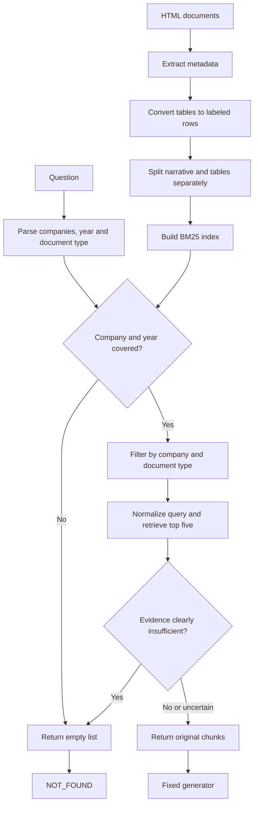

# FTEC5660 Homework 4

## Homework 4 solution

### Pipeline

The parser reads the company, document type and reporting year from the document opening. HTML tables are converted into rows containing their labels, column headers and original cell values, with captions retained for units. V6 traverses the document in order and splits narrative and tables separately: every chunk is at most 1,500 characters, with source, company, fiscal\_year and doc\_type metadata; table captions are repeated on their table chunks. BM25 indexes normalized lexical tokens. A question parser uses the provided make\_llm() and caches results within the current process. The retriever uses normalized company identities and document type to filter candidates, removes company names from the ranking query because identity is already represented by metadata, and returns at most five original chunks ranked by BM25. It rejects missing companies and unsupported annual-report years before retrieval, then uses an LLM evidence-sufficiency check to reject clearly unsupported requests. Uncertain or failed sufficiency checks preserve retrieval. The generator remains fixed. No embeddings, external data sources, stored public-corpus index or hard-coded company answers are used.

### Experimental design

Each row changes one conceptual component relative to the preceding row. B0 uses BeautifulSoup get\_text(), RecursiveCharacterTextSplitter with a 1,500-character size and 150-character overlap, required metadata, and global BM25 top five using lowercase whitespace tokens. It neither parses questions nor abstains. V1 changes table representation; both the conversion function and its integration into document extraction must change to make the representation available to retrieval. V2 introduces self-query metadata retrieval as one component (LLM parsing plus company/type filtering). V3 changes lexical preprocessing as one component (punctuation/possessive normalization, stop-word removal, and removal of parsed company names from ranking queries). The experiments do not isolate the individual substeps inside V2 or V3. V4 adds deterministic abstention, V5 adds evidence-based abstention, and V6 changes chunk boundaries and caption preservation. No explicit per-company retrieval quota or year-based candidate-ranking filter is implemented.

All metrics below are recomputed from the archived results CSV files. These are development-set results, not an independent held-out evaluation. Each row records one observed run; no mean or variance across repeated model runs is claimed.

|Version|Change from preceding row|Recall@5|Answerable kept|Unanswerable rejected|Answer accuracy|
|-|-|-:|-:|-:|-:|
|B0|Required naive baseline|39.1% (18/46)|100.0%|0.0%|48.3% (29/60)|
|V1|Labeled table text|34.8% (16/46)|100.0%|0.0%|50.0% (30/60)|
|V2|Query parsing and company/type filtering|41.3% (19/46)|100.0%|0.0%|56.7% (34/60)|
|V3|Lexical preprocessing|100.0% (46/46)|100.0%|0.0%|98.3% (59/60)|
|V4|Company/year coverage abstention|100.0% (46/46)|100.0%|71.4% (10/14)|98.3% (59/60)|
|V5|LLM evidence-sufficiency check|97.8% (45/46)|97.8% (45/46)|100.0% (14/14)|98.3% (59/60)|
|V6|Ordered, separate table/narrative chunking|100.0% (46/46)|100.0%|100.0% (14/14)|98.3% (59/60)|

In the recorded runs, table-cell preservation rose from 0% in B0 to 100% in V1 and stayed there. Document validation passed for all 40 documents in every version. Query parsing scored 0% through V1 and 100% from V2 onward. Chunk counts were 236 for B0, 283 for V1–V5, and 616 for V6. These additional figures come from the saved run observations and code/document checks; the CSV files alone do not record table scores or chunk counts.

### Analysis

**Table representation (B0 to V1).** Explicit row/column labels made tables independently interpretable and achieved full table-cell preservation, but recall declined by 4.3 percentage points. Expanded text changed chunk boundaries and BM25 statistics without improving ranking enough to compensate. The experiment establishes that table preservation alone is insufficient; it does not identify a single cause for every ranking change. Answer accuracy nevertheless improved by one question. Retrieval-hit and answer-accuracy criteria differ, including exact evidence text versus numeric tolerance, so these metrics need not move together.

**Metadata retrieval (V1 to V2).** Parsing correctly extracted the three required fields on the public questions. Filtering removed many irrelevant companies and document types, raising recall to 41.3% and accuracy to 56.7%. It did not guarantee the correct financial passage within a company's reports. Because parsing and filtering were introduced together, their separate contributions cannot be estimated from this ablation.

**Lexical preprocessing (V2 to V3).** Normalization reduced punctuation and possessive mismatches, removed generic question words, and prevented already-filtered company names from dominating ranking. Recall rose to 100% and accuracy to 98.3%. This is evidence for the preprocessing component as a whole, not proof that each substep is individually necessary. No additional tokenizer variants were selected to chase individual answers.

**Abstention (V3 to V5).** The deterministic coverage rule rejected 10 of the 14 unanswerable questions without discarding answerable ones. Annual-report coverage is inferred from each report's fiscal year and its prior-year column, following the supplied corpus structure; this rule is not applied to earnings-call guidance or research forecasts. The sufficiency check then rejected all remaining unanswerable requests, but also rejected one answerable comparison. Its improved rejection rate therefore came with a measurable false-rejection cost. A generator answering NOT\_FOUND despite receiving chunks does not count as retriever abstention, explaining why V3 had high answer accuracy but zero rejection rate.

**Chunk boundaries (V5 to V6).** A diagnostic inspection found mixed financial-statement chunks and a cash-flow passage ending after beginning-of-year cash. V6 separates table and narrative blocks and repeats table captions while retaining document order. All answerable questions were kept and all required evidence was retrieved; the previously rejected comparison was answered correctly. End-to-end accuracy stayed at 59/60 because a different numeric question became wrong. The structural change improved retrieval and abstention reliability on this run, but did not improve overall answer accuracy. An exploratory table-first ordering was rejected during offline diagnostics because it displaced narrative evidence under tied lexical scores; it was not a full model run and is not an ablation-table row.

### Remaining error and limitations

V6's remaining error is q050, asking for Brightwater Software's FY2023 revenue in Europe, Middle East and Africa. The required printed evidence was present according to the provided retrieval scorer, but the fixed generator returned 158.1 rather than 493.5. This is consistent with selecting a wrong figure from retrieved context; the CSV alone does not establish the precise reasoning failure. Retrieval scoring checks document/text evidence presence and is weaker than proving unambiguous, complete contextual interpretation. The V4/V5 comparison error likewise showed that a numeric evidence hit can coexist with confusing beginning/end-of-year context. The fixed generator was not changed, and no question-specific correction was added.

All configurations were developed using the same public set. Company names, file IDs, expected answers and ground-truth records appear only in evaluation artifacts or this error discussion; the retrieval implementation does not read them as a lookup table. Private-set generalization remains unmeasured. In particular, lexical matching has no stemming or systematic synonym expansion: a headquarters question can receive all-zero BM25 scores when the query uses 'headquartered' and the text uses 'headquarters', making source order influential. Metadata extraction assumes the documented HTML opening structure. The sufficiency check can misjudge evidence and fails open on API/output errors. The query parser's malformed-JSON and API exceptions are caught by the provided runner per question, but may still cost parsing/retrieval points. Dependencies are unpinned, and deterministic-looking model settings do not guarantee identical future outputs. These are retained limitations, not grounds for more public-answer-specific tuning.

The observed V6 run took 120.1 seconds, within the 30-minute limit. Reported usage was 110 custom LLM calls and 46 generator calls, with an estimated combined cost of USD 0.0273 under the runner's pricing constants. The displayed 62.6-second 'index' time includes earlier parsing/evaluation work because of where the provided runner starts and reads its timer; it is not pure BM25 construction time. No claim is made that a fresh-clone/API run has been performed in the review environment.

